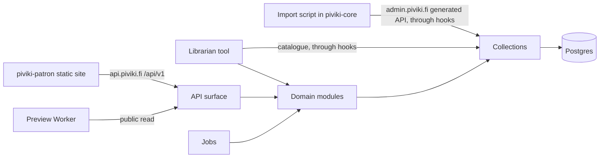
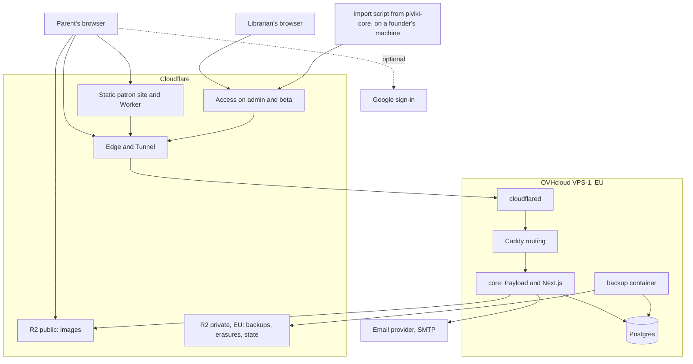
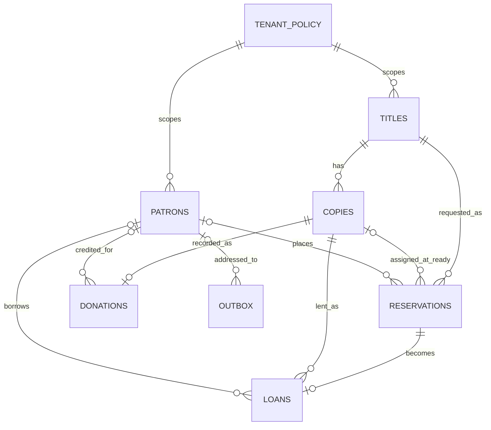

# Architecture Spine: Piviki MVP

## Design Paradigm

**Modular monolith behind a versioned API, with a static headless frontend.** `piviki-core` is the only system that holds state or applies rules. Everything else is a client of it.

| Layer | Lives in | Owns |
|---|---|---|
| API surface | `piviki-core/src/api/v1` | Patron and public HTTP contract; no rules |
| Domain modules | `piviki-core/src/modules/{circulation,notifications,accounts}` | Every business rule and state change |
| Persistence | `piviki-core/src/collections` | Schema and access control through Payload |
| Librarian tool | Payload admin plus `piviki-core/src/admin` custom views | Librarian screens; rules stay in modules |
| Jobs | `piviki-core/src/jobs` | Scheduled triggers that call modules |
| Patron site | `piviki-patron` | Static screens and the preview Worker; no rules |
| Import script | `piviki-core/scripts/import`, run on a founder's machine | Turns scans into draft catalogue records over the generated API, once |
| Infrastructure | `piviki-infra` | Provider configuration, Compose file, host bootstrap, runbooks |

## Invariants & Rules

### AD-1: Core owns all state and rules [ADOPTED]

- **Binds:** all
- **Prevents:** rules or data forking between the patron site, librarian tool and import script.
- **Rule:** Only `piviki-core` and the read-only backup container reach Postgres. The patron site, Worker and import script hold no business rules and reach data only over HTTP.

### AD-2: One circulation module performs every circulation change [ADOPTED]

- **Binds:** R4, R5, R6, R7, R10, R14, R15, R18, R23, R24
- **Prevents:** a form, endpoint or job changing circulation state without the queue, overdue, limit and renewal checks, and concurrent operations breaking them.
- **Rule:**
  - Reservations, loans and copy state change only through `modules/circulation`. They are read-only in Payload admin and denied on the generated API. Creating a copy through the admin or generated API is allowed; core sets its state to `available`.
  - Each operation runs in one database transaction. It locks the patron's row first when a patron is involved, then each affected title's row in ascending id order. Limits, the overdue block and "holds a book" are checked under the patron lock.
  - Adding a copy, deleting a copy or title, merging titles, and unpublishing a title affect circulation, so collection hooks route them through the module. Adding a copy re-runs queue promotion. Deletion is refused for any record with a reservation, loan or donation, and copies leave service through `lost`. Unpublishing is refused while a title has open reservations or active loans.
  - A renewal is refused while the title has a `queued` reservation.
  - The overdue block is the only consequence of being late. No fee or fine fields exist.

### AD-3: One reservation entity, with availability defined once

- **Binds:** R3, R4, R6, R14, R23, R24
- **Prevents:** double-booking, queue-jumping, and epics modelling a queue or availability differently.
- **Rule:**
  - A queue place is a reservation in state `queued`; there is no separate collection. Every reservation references a title and gets a copy only on the move to `ready`. Queue order is creation time, then id, and never changes on promotion.
  - The stored copy state is the source for availability. `free` = copies in state `available`, minus reservations in `queued` or `reserved`.
  - A title's public `availability` is `available` if `free` > 0, `on_loan` if `free` <= 0 and at least one copy is not `lost`, and `unavailable` otherwise. This enum exists from the first `openapi.json`. Before `reservations` exists, its term in the formula is zero.
  - Reserving creates `reserved` when `free` > 0, creates `queued` when the title is `on_loan`, and is refused with a stable code when `unavailable`.
  - When a copy becomes available, the oldest `queued` reservation moves to `reserved`. A librarian then marks it `ready`.
  - Only the loan records return or loss. A loan is one hand-over: a renewal updates `dueDate` and `renewalCount` on the same row.

### AD-4: Time-dependent states are derived, not stored

- **Binds:** R7, R9, R10, R15
- **Prevents:** a missed job leaving the overdue block or the 7-day flag wrong, or anything expiring on its own.
- **Rule:** Overdue is computed from an active loan's due date, and the uncollected flag from the ready time and the policy window, at read time. Jobs send emails but never set these states. Only a librarian moves a reservation to `expired`. Due dates are calendar dates in the tenant's time zone (`Europe/Helsinki`); all other times are UTC. A loan is overdue from the day after its due date.

### AD-5: Two API surfaces with separate hosts and callers

- **Binds:** R1, R2, R3, R4, R5, R6, R13, R24
- **Prevents:** patrons reaching raw collections, Payload defaults opening data, and the patron site and core drifting apart.
- **Rule:**
  - `api.piviki.fi` serves only `/api/v1/*`, enforced by a path allowlist in Caddy. It is the only surface for the public, patrons and the Worker. All patron auth, including login, logout, session, refresh, verification, password reset and Google, sits behind `/api/v1/auth/*`.
  - `admin.piviki.fi` serves Payload admin and the generated REST API, to librarians only. The one-time import script calls it with a librarian account's API key.
  - Every collection is built from a helper whose access defaults to deny. One test loops over all collections, including internal ones, and asserts a patron session is refused every operation.
  - GraphQL is disabled, `first-register` is blocked at Caddy and refused in a hook, and `jobs.access.run` returns false. A deploy check confirms `first-register` returns 404. The first librarian is seeded over SSH before any public DNS record exists.
  - `/api/v1` handlers accept only a `patrons` session for patron operations, make no state change on GET, and send `Cache-Control: private, no-store` on authenticated responses.
  - Core publishes `openapi.json` for `/api/v1`; `piviki-patron` generates its types from it and never hand-writes them.
  - Within `v1`, changes only add, because the two deploy separately. Errors use `{ "error": { "code", "message" } }` with stable codes, and the patron site translates by code. A patron's own reservations and loans return the title's display fields regardless of later catalogue changes.

### AD-6: Tenancy is data and policy only

- **Binds:** R20, R25
- **Prevents:** adding a second tenant requiring a data migration, or rule values hard-coded in modules.
- **Rule:**
  - Every library-owned record has a required `tenant` reference, set by core from server configuration and never accepted from a client. Every query goes through a shared access filter on it. A patron belongs to one tenant, and email is unique per tenant.
  - Loan period, maximum books, renewal rules, retention period, inactivity window, uncollected window, time zone, `signupOpen` and `currentPolicyVersion` live in one `tenant-policy` record, read only through `modules/circulation/policy`.
  - The record is seeded by a migration. After that a developer changes values by running a `policy:set` command in the core container, which validates them and records who, when and what, with no commit or deploy.
  - Chat group links and the beta allowlist are server configuration values, because repositories are public. Core serves the links only through `/api/v1` after the gate is passed.
  - There are no tenant-switching or policy screens.

### AD-7: Patrons and librarians are separate identities in core

- **Binds:** R2, R19, R22, R23
- **Prevents:** a patron session or the patron site's origin reaching the admin, or a second account store to keep in step.
- **Rule:**
  - `patrons` and `librarians` are separate Payload auth collections, and accounts exist only in core. Only `librarians` can access admin. Librarian accounts are created by a librarian or developer, with no public sign-up.
  - Patrons sign in with email and password or Google. Librarians use email and password, behind Cloudflare Access with an email one-time PIN on all of `admin.piviki.fi`. The one-time import script uses a librarian account's API key and a Cloudflare Access service token, both revoked after the initial load.
  - Sessions are HTTP-only cookies from core: `secure`, `SameSite=Lax`, host-only, with tokens removed from response bodies. Patron sessions last about 7 days with refresh, and librarian sessions about 8 hours. Logout, password reset and deletion end the session.
  - Caddy rejects admin requests whose `Origin` is present and is not `https://admin.piviki.fi`. CORS and CSRF lists hold exact origins, and `beta.piviki.fi` is removed at launch.
  - Minimum password length is 12 for librarians and 10 for patrons. Sign-up, login and reset responses do not reveal whether an email has an account.

### AD-8: Sign-up gate, Google linking and the pre-launch period

- **Binds:** R2, R19
- **Prevents:** any path around the adult tick and policy acceptance, account takeover through Google, test records reaching launch, and the epics being unable to verify in production.
- **Rule:**
  - A patron has `emailVerifiedAt`, `gateAcceptedAt`, `policyVersion` and `donorConsentAt`. Every `/api/v1` write except verifying email, completing the gate or deleting the account returns `gate_required` until email is verified, the gate is accepted and `policyVersion` equals `currentPolicyVersion`. Core copies the version when the gate completes and never accepts it from a client. Developers bump it only for a material change.
  - Donor consent is a separate, optional, unticked choice.
  - Google uses small `openid-client` endpoints under `/api/v1/auth/google/*`: the authorization code flow with state and PKCE bound to a short-lived HTTP-only cookie, an exact redirect URI, and scopes `openid email`. A Google identity is the `sub` value. It links to an existing patron only when Google reports the email verified. If the local account is unverified at that point, its password is replaced with a random value and its sessions end.
  - While `signupOpen` is false, `modules/accounts` allows sign-up and sign-in only for emails on the beta allowlist, on every path including Google. Before the flag flips, `epic-launch` runs one reset that hard-deletes allowlisted patrons with their reservations, loans and outbox rows and returns affected copies to `available`. The flag stays false until the privacy notice and usage policy are published and the processor agreements in AD-18 are on file.

### AD-9: Catalogue writes and review

- **Binds:** R3, R11, R12, R13, R14, R17
- **Prevents:** unreviewed scans going public, duplicate titles or queues on import, imports left half-finished after a re-run, re-runs overwriting a librarian's corrections, the script touching circulation, or copies with no identity an ILS can import.
- **Rule:**
  - Only `titles` has drafts. `copies` are not versioned and are visible only through a published title. `/api/v1` exposes only published titles.
  - Every title is created as a draft unless the create payload sets `_status: 'published'`. This applies to every writer, including the import script.
  - `copies.barcode` identifies one physical copy and has a unique index. Core assigns it on create from one database sequence that a migration creates, whoever creates the copy. A client-sent barcode is refused, and a barcode never changes. The format is the prefix `PVK` and a zero-padded number, at most 20 ASCII characters. Barcodes are never reused, including after deletion or loss. Gaps in numbering are allowed.
  - One core function `catalogue/matchKey` computes a title's key, scoped to the tenant. With any ISBN not qualified `set`, titles match when such an ISBN is shared and the first series entries have equal numbers. When the new title has no ISBN not qualified `set`, the key is the AD-10 search-normalised title, the normalised full name of the first `aut` contributor, and the first series entry's `seriesKey` and number with leading zeros removed. A title with an empty title has no key and never matches.
  - Duplicate checks are serialised across the catalogue, so two concurrent creates cannot both pass. A title create, or a publish of a draft, that matches another title is refused with HTTP 409 and `data.code` `duplicate_title`, carrying the oldest match's id, unless the payload sets `allowDuplicate: true`. The librarian tool shows the match and offers that override; the import script never sends it. Clients read `errors[0].data.code`, Payload's error shape on the generated API, which deliberately differs from `/api/v1`'s.
  - The initial load runs once, single-threaded, and gives each title exactly one copy. The script uploads the images, creates the draft title, then creates its copy, through the generated API. After `duplicate_title` it creates no copy and logs the scan as skipped. It keeps a local file of processed scans and skips them on a re-run; core stores nothing about scans. The review view flags draft titles with no copy and images attached to no title, so a run that died part-way is completed by hand before publishing. The import script only creates records; it never updates, publishes or deletes. Further copies are added by librarians.
  - Merging draft titles in the review view moves their copies, barcodes unchanged, to the kept title; no copy is deleted by a merge.
  - `epic-librarian-catalogue` owns finding a copy by barcode, the label view, the review view with merging, API keys on librarian accounts, and the Cloudflare Access service token the import script uses. Every librarian screen that acts on a copy finds it by barcode, typed or scanned. The label view prints labels only for copies of published titles, and records which copies are labelled.
  - "Import" in R13 means publishing: a librarian reviews every record in the production review view and publishes it. Draft images can be fetched by unguessable URL before review, which is accepted given AD-16's metadata and crop rules.

### AD-10: Vietnamese text is normalised one way

- **Binds:** R1, R3, R13
- **Prevents:** scans, manual entry and typed searches failing to match because of Unicode form or diacritics.
- **Rule:** Core converts all stored bibliographic text to Unicode NFC on write. Search runs only against a core-maintained normalised column: lowercased, diacritics removed, and `đ` mapped to `d`. The same function normalises the query, and diacritic-free and exact queries both match.

### AD-11: Language handling

- **Binds:** R1, R8, R9, R10, R22, R23
- **Prevents:** languages being added by code changes, or emails and screens disagreeing about language.
- **Rule:** Language codes are BCP 47 (`vi`, `en`), with `vi` the default. Patron URLs start with `/{lang}/`. A patron's language is stored on their account and chosen on the site; core renders all patron email, including password reset and verification, in it from message files with named keys. All user-visible text comes from message files, in the patron repo for screens and in the core repo for email and librarian text. Adding a language adds files, not code. Bibliographic data is not translated. A book's own languages use MARC language codes (`vie`, `eng`) under AD-20, never BCP 47. Librarian screens use English through Payload's i18n.

### AD-12: Library email goes through one outbox

- **Binds:** R8, R9, R10, R23
- **Prevents:** duplicate reminders on retry, a state change committing with its email lost, mismatched row formats between epics, and mail to deleted patrons.
- **Rule:**
  - Only `modules/notifications` sends library email. Circulation writes an outbox row in the same transaction as a state change, and the reminder job writes rows through notifications.
  - A row holds `kind`, `subjectType`, `subjectId`, `patron` and `dedupeDate`, unique together, with no address, name or rendered text.
  - A job delivers pending rows with retries. It resolves recipient, language and content at send time, re-checks that the row still applies, and marks it `dropped` if the patron is null or the condition has ended. Delivery is at-least-once.
  - `dedupeDate` is a `Europe/Helsinki` calendar date: the due date for reminders, the due date plus 7n days for overdue notices, and the transaction date for state-change emails. Sent rows are deleted after a short period.
  - All mail leaves through one Nodemailer SMTP adapter on a transactional service on the library's own domain. Personal Gmail and Proton are not options, and open and click tracking are off. `epic-librarian-catalogue` sets up the adapter and domain, and `epic-reservation-loop` adds the outbox and delivery job.

### AD-13: Jobs run in one place

- **Binds:** R9, R10, R19
- **Prevents:** a schedule firing twice, schedules not starting after a restart, or work depending on the host's cron.
- **Rule:** All application scheduled work uses Payload's Jobs Queue with `autoRun` in the one core container, initialised at boot, not on the first request. A test confirms jobs run after a restart with no requests. Core runs as a single instance; running more than one requires replacing `autoRun` first. A job only calls a module, must be safe to run again, and stores ids only. The backup container in AD-17 is the one exception.

### AD-14: Personal data rules

- **Binds:** R2, R16, R17, R18, R19, R23
- **Prevents:** data the privacy notice does not cover appearing in the system, and deletion or retention missing a record.
- **Rule:**
  - The system holds no data about children, and the pickup address is stored nowhere in the system or its repositories.
  - Patrons hold only `tenant`, name, email, language, the AD-8 fields, Google `sub` and an optional phone number that only librarians can read or set. No collection that references a patron uses versions.
  - Donations store copy, optional donor and date, with no free-text identity. A donor can be linked only when `donorConsentAt` is set. No donor name reaches `/api/v1`.
  - `modules/accounts` is the only path for account deletion and retention. Admin and generated deletes on `patrons` are denied. Deletion calls one `modules/circulation` withdrawal, in the same transaction that removes the patron, covering cancellation, lost marking, queue promotion, and nulling links on loans, reservations, donations and outbox rows. A patron can delete their account only when holding no book; a librarian can delete it at any time, which marks held copies lost.
  - A marked-lost title with no other copy has its `queued` and `reserved` reservations cancelled, and those patrons are emailed.
  - An account with no activity for the policy's inactivity window, starting at 1 year, is deleted through the same `modules/accounts` path, without a warning email. Activity is a sign-in, reservation or loan event. An account holding a book or an open reservation is never deleted for inactivity.
  - The retention job nulls the patron link on loans counted from `returnedAt` or `lostAt`, on `picked_up` reservations with their loan, and on `expired` or `cancelled` reservations counted from their end time.
  - A canary test takes a patron through reservation, loan, email and donation, deletes them, runs `pg_dump` and fails on any match for their email, name or id. It repeats for retention by moving the clock.
  - Logs and error reports carry record ids, never names, emails, phone numbers, tokens, request bodies or query strings. Logs rotate at about 30 days, and the notice states this and that they hold IP addresses. A record-ids-only log of librarian logins and generated writes is kept about 90 days.

### AD-15: Patron site delivery [ADOPTED]

- **Binds:** R1, R3, R21
- **Prevents:** server rendering creeping in, or a preview failure breaking the page.
- **Rule:**
  - `piviki-patron` is a Next.js `output: 'export'` build on Cloudflare static assets, using Mantine. Live data loads in the browser from `/api/v1`. No analytics or third-party scripts run on it, and its headers set a Content-Security-Policy, HSTS and `Referrer-Policy: no-referrer`.
  - Book URLs are `/{lang}/book/{id}`, built from one placeholder route, `/{lang}/book/_`. The page reads the id from the URL in the browser, and links to book pages are plain links.
  - A Worker runs on `/*/book/*`, with `not_found_handling` set so asset misses stop at the asset layer. It serves the shared book page and sets preview tags from one public read of a published title. If the read fails or takes over 1 second, it serves the unmodified page. It holds no rules, secrets or personal data.

### AD-16: Media and backups use separate buckets

- **Binds:** R3, R11, R13, R19
- **Prevents:** patron data or a home location in a public bucket, and backups lost with the server.
- **Rule:** Front covers, back covers and publishing information pages go to a public Cloudflare R2 bucket through Payload's S3 adapter, with unguessable names and no listing. Only catalogue images go there. The import script strips metadata and crops to the book before upload and before any LLM call, and the media collection re-encodes every stored original; a test confirms a GPS-tagged upload keeps no EXIF. The review checklist rejects handwritten names and backgrounds. Database backups go to a separate private bucket created in R2's EU jurisdiction.

### AD-17: Deployment and operations

- **Binds:** all
- **Prevents:** builds on the host, an exposed origin or database, untested backups, unpatched software, and a launch cutover nobody owns.
- **Rule:**
  - **Host:** one OVHcloud VPS-1 [ADOPTED], month to month, in an EU data centre, runs `cloudflared`, `caddy`, `core`, `postgres` and `backup` under Docker Compose. The running cost stays within 15 EUR a month. Postgres has no published port.
  - **Ingress:** Cloudflare Tunnel is the only route in. The host opens no inbound 80 or 443, only SSH by key. Caddy does host and path routing on the private network. A scan from outside confirms this before the first real data.
  - **Build and deploy:** GitHub Actions builds images tagged by commit and pushes them to GitHub Container Registry; the host only pulls them, through a limited deploy user. Third-party Actions are pinned to a commit. Payload migrations run before the new core starts, and each must work with the previous version until that deploy is confirmed. Rollback is redeploying the previous tag and fixing schema forward.
  - **Hardening:** core runs as non-root with a read-only filesystem and no Docker socket, on a non-superuser Postgres role. Automatic OS security updates are on. Login, reset and sign-up are limited by one Cloudflare rule, a limiter in core and Payload's lockout, plus a per-address email send limit.
  - **Patching:** Dependabot and secret scanning are on in all repositories, and images are rebuilt monthly. A critical internet-reachable flaw is patched within 72 hours, or core is taken offline.
  - **Backups:** from before the first data that cannot be recreated, the initial load, the `backup` container, with its own read-only role and R2 token, sends a nightly `pg_dump` encrypted to a public key with `age`. Both founders hold the private key offline. A lifecycle rule deletes dumps after 30 days, a 7-day bucket lock protects recent ones, and a heartbeat alerts when a dump is missed. On deletion, `modules/accounts` writes `erasures/{patronId}` with no other data to the private bucket, and a restore re-deletes those ids before the app starts. A restore is tested before the bulk import and yearly. OVH's included backup is listed in the data inventory.
  - **Recovery:** rebuild from `piviki-infra` and the latest dump; the target is one working day.
  - **Environments:** local and production only. Until launch, the patron site is on `beta.piviki.fi`, behind Cloudflare Access, with `noindex`, and `piviki.fi` stays the coming-soon page.
  - **Cutover:** `epic-launch` owns the switch: run the AD-8 reset, add `piviki.fi` to origins and Google redirects, point `piviki.fi` at the patron site, set `signupOpen`, and retire `beta`.
  - **Infrastructure as code:** OpenTofu manages Cloudflare resources including DNS, with encrypted state in the private bucket. `piviki-infra` holds the Compose file, host bootstrap, a secrets inventory by name, and the breach runbook. The VPS itself is ordered by hand. Each service gets only its own secrets from a root-owned file, and a shared password manager holds them. Every provider console uses each founder's own login with MFA.
  - **Breach readiness:** before `signupOpen`, the runbook names a primary and backup owner, a monitored role address, a free uptime monitor, and the steps to notify the Ombudsman within 72 hours and tell patrons.

### AD-18: Processors and code ownership

- **Binds:** R19, and the initiative's GDPR and ownership constraints
- **Prevents:** patron data reaching a provider the privacy notice does not name.
- **Rule:** In the system, patron data may reach only OVHcloud, Cloudflare, the chosen email provider and, for patrons who choose it, Google. Each is named in the privacy notice, with its agreement on file where one applies, before `signupOpen`. Adding any other requires updating both first. The LLM used by the import script and GitHub hold no patron data. Repositories are MIT licensed [ADOPTED], held in the `pivikirjasto` GitHub organisation, and checked for personal details and the pickup address before going public.

### AD-19: Each collection has one creating epic

- **Binds:** all
- **Prevents:** two epics creating one collection or shipping incompatible first versions.
- **Rule:** Later epics extend a collection only by migration.

| Epic | Creates |
|---|---|
| `epic-librarian-catalogue` | `tenant-policy`, `librarians`, `titles`, `copies`, `media`, `donations`, and `patrons` with its full AD-14 fields and no public route |
| `epic-initial-load` | No collection; it uses a librarian account |
| `epic-patron-site` | Patron auth endpoints, the gate, and the availability function |
| `epic-reservation-loop` | `reservations`, `loans`, `outbox` |

### AD-20: One bibliographic shape for every writer

- **Binds:** R3, R11, R12, R13
- **Prevents:** the import script, manual entry and ISBN lookup storing names, languages or classes differently, and a later MARC 21 export or ILS migration needing records catalogued again.
- **Rule:**
  - Every writer of `titles` uses the same structured fields. Only `title` is required, and core validates the shape of every field on write.

    | Field | Shape |
    |---|---|
    | `contributors` | Ordered list of `{ name, entryName, entryElement, role }`. `name` is the full name as written on the book. `entryName` is the part a catalogue files under. `entryElement` is `surname`, `forename` or `family`. `role` is a MARC relator code, such as `aut`, `ill` or `trl` |
    | Title | `title`, `subtitle` and `responsibility` (statement of responsibility), kept separate |
    | `series` | Ordered list of `{ title, number }`. `title` is the series name as printed; `number` is text, such as `3` or `3A`. Core keeps an AD-10 search-normalised `seriesKey` per entry, and books are found by series through it |
    | `isbns` | List of `{ isbn13, qualifier }`, normalised to ISBN-13 without hyphens. `qualifier` includes `set` for an ISBN that covers a whole series |
    | `languages` | List of MARC language codes, validated against the MARC code list; the first is the main language. Defaults to `[vie]` |
    | `audience` | `juvenile` or `general`. Defaults to `juvenile` |
    | `classifications` | List of `{ scheme, notation, edition }`. `scheme` is `ykl` or `ddc`; `edition` is used only for DDC. Only notations are stored, never DDC captions |

  - Other descriptive fields and copy fields are left to the code, as optional fields that core adds by migration.

## Consistency Conventions

| Concern | Convention |
|---|---|
| Repositories | `piviki-core`, `piviki-patron`, `piviki-infra`, side by side in the workspace root; the import script lives in `piviki-core/scripts/import` |
| Hosts | `api.piviki.fi` for `/api/v1`; `admin.piviki.fi` for the librarian tool and generated API; `piviki.fi` for the patron site |
| Collections | Plural kebab-case slugs: `titles`, `copies`, `reservations`, `loans`, `donations`, `patrons`, `librarians`, `tenant-policy`, `media`, `outbox` |
| Ids and dates | Postgres-generated ids in API responses as strings, never reused; ISO 8601 UTC timestamps and `YYYY-MM-DD` due dates in APIs and storage; every date shown to people, on screens, emails and labels, is `dd-mm-yyyy` in `Europe/Helsinki` |
| Reservation states | `queued`, `reserved`, `ready`, `picked_up`, `expired`, `cancelled`. Leaving a queue is `cancelled`, never a delete |
| Loans | `reservation`, `copy`, `patron`, `startedAt`, `dueDate`, `renewalCount`, `returnedAt`, `lostAt`. Active while both end fields are null |
| Copy states | `available`, `held`, `on_loan`, `lost` |
| Copy identity | `copies.barcode` per AD-9; the database id never appears on a label or in a patron-facing response |
| API paths | Plural nouns under `/api/v1`, with public reads under `/api/v1/public` and auth under `/api/v1/auth` |
| Testing | Modules have unit tests against a real Postgres; every patron endpoint has a test that one patron cannot read or change another's data |

## Stack

| Name | Version |
|---|---|
| Node.js | 24.22.2 |
| TypeScript | 6.0.3 |
| Payload (`payload`, `@payloadcms/next`, `db-postgres`, `storage-s3`, `email-nodemailer`) | 3.92.1 |
| Next.js | 16.4.4 |
| React | 19.3.1 |
| Mantine (patron only) | 9.7.4 |
| `openid-client` | 6.8.9 |
| PostgreSQL | 18.6 |
| Caddy | 2.11.7 |
| `cloudflared` | 2026.10.7 |
| `age` | 1.3.2 |
| OpenTofu | 1.13.2 |
| Wrangler | 4.156.1 |

## Structural Seed

## Capability → Architecture Map

| Capability | Lives in | Governed by |
|---|---|---|
| R1 Vietnamese and English patron screens | `piviki-patron` | AD-5, AD-11, AD-15 |
| R2 Sign-up and chat invitation | `api/v1/auth`, `modules/accounts`, `piviki-patron` | AD-6, AD-7, AD-8, AD-14 |
| R3 Browse and search | `api/v1/public`, `piviki-patron`, Worker | AD-3, AD-9, AD-10, AD-15, AD-16 |
| R4, R24 Reserve, queue, cancel | `modules/circulation` | AD-2, AD-3 |
| R5 Account view | `api/v1`, `piviki-patron` | AD-4, AD-5 |
| R6, R7 Renewal and overdue block | `modules/circulation` | AD-2, AD-3, AD-4, AD-6 |
| R8, R9, R10 Emails | `modules/notifications`, `jobs` | AD-4, AD-11, AD-12, AD-13 |
| R11, R12 Manual entry and ISBN lookup | Payload admin | AD-2, AD-9, AD-20 |
| R13 Scan import | `piviki-core/scripts/import`, review view | AD-7, AD-9, AD-10, AD-16, AD-20 |
| R14, R15, R18 Pickup loop, flags, phone | `src/admin`, `modules/circulation` | AD-2, AD-4, AD-9, AD-14 |
| R16 Pickup address outside the system | Chat links in server configuration | AD-6, AD-14 |
| R17 Donations | `collections/donations`, `modules/accounts` | AD-8, AD-9, AD-14 |
| R19, R23 Privacy, deletion, retention, lost copies | `modules/accounts`, `modules/circulation` | AD-2, AD-12, AD-14, AD-17 |
| R20, R25 Policy and tenancy | `tenant-policy`, `policy:set` | AD-6 |
| R21 Replacing the coming-soon page | `piviki-infra`, Cloudflare | AD-15, AD-17 |
| R22 English librarian tool | Payload i18n | AD-11 |

## Assumptions to Prove

| Assumption | Prove in | If it fails |
|---|---|---|
| Payload runs on two hostnames with one container, with working admin, cookies and reset links | First `epic-librarian-catalogue` story | Keep one host, put Access on admin and librarian paths, and require a separate browser profile for librarians |
| Thin `/api/v1/auth/*` handlers can issue and clear Payload's cookie | First `epic-patron-site` story | Expose the listed generated auth operations through Caddy and map their errors |
| The Worker stays under the 10 ms CPU limit on the free plan; exceeding it returns Error 1102, which the Worker cannot catch | First `epic-patron-site` story | Paid Workers plan, or remove previews |
| `@payloadcms/storage-s3` uploads to R2 with the current AWS SDK | First upload story | Set checksum options to `WHEN_REQUIRED` |
| Cloudflare's free rate limit rule can cover all sensitive paths | First deploy | Rely on the limiter in core |
| Cuttable work (R12, R6, R9, the English interface) can be removed without touching never-cut work | Each epic's review | Replan with the product owner |

## Open Questions

| Question | Owner | Decide by | Affects |
|---|---|---|---|
| Does the patron list reveal ethnic origin under GDPR Art. 9, and if so which condition applies? Is an impact assessment needed? | Founders, from tietosuoja.fi | Before `epic-patron-site` closes the gate wording | AD-8, AD-14, whether Cloudflare stays in the API path |
| What retention applies to proof of acceptance after deletion? Do backups with re-deletion satisfy erasure? | Founders | Before `signupOpen` | AD-14, AD-17, privacy notice |
| Who is the controller for the chat groups, what is Google's role, and do online terms satisfy the written agreement requirement? | Founders | Before `signupOpen` | AD-18, privacy notice |
| Loan period, maximum books and renewal limits for the first loan | Stakeholders | End of December 2026 | `tenant-policy` seed |
| Who writes the privacy notice (the other founder writes the usage policy), and where are both published? | Founders | Before `signupOpen` | AD-8, Done-when |

## Deferred

| Decision | Why it can wait | Decide by |
|---|---|---|
| Email provider | Any SMTP service on the library's domain with an agreement fits AD-12 | `epic-librarian-catalogue` |
| OVH data centre (Germany or Poland preferred) | No effect on any unit | When ordering |
| ISBN lookup source | Cuttable, and behind one lookup function; candidate in research §4 | `epic-loan-care` |
| Barcode sequence after a restore | `pg_dump` restores the sequence, but barcodes issued after the last dump could be reissued; candidate fix is advancing the sequence by a margin before core starts | Before relying on restores in production |
| MARC 21 export and OAI-PMH | No unit produces records for another system in the MVP; format and library in research §5 | When a library or consortium asks for records |
| Vision model for scans | Internal to the import script | `epic-initial-load` |
| Success-signal reports | Fields exist through AD-3 and the Loans convention; deleted patrons drop out of family counts, as decided | `epic-launch` |
| Coarsening old loan dates | Depends on the anonymisation question | With the retention question |
